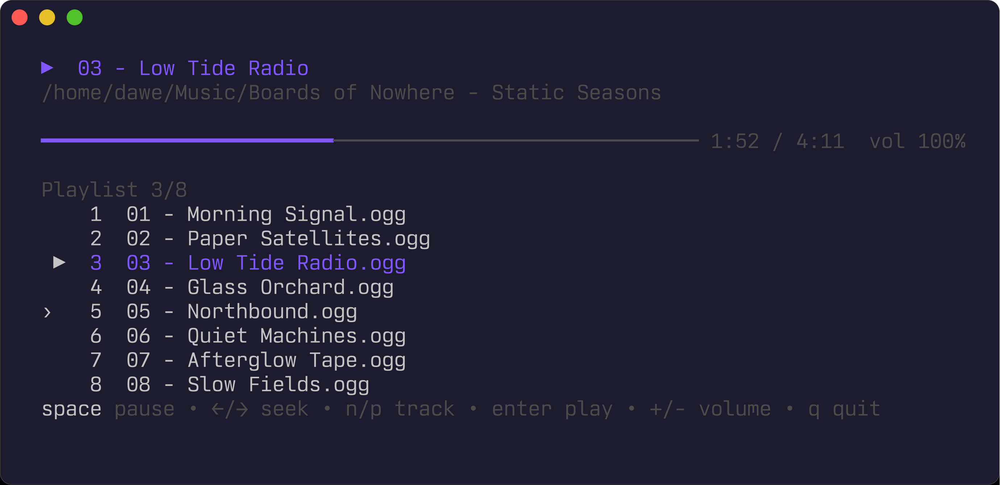

# tplay

[](https://github.com/dzhenetl/tplay/actions/workflows/ci.yml)

Minimal terminal audio player. It plays the file you open and puts every audio
file from the same directory into a playlist, without any library setup.

Decoding is done by `ffmpeg`, so any format it supports plays.



## Usage

```sh
tplay [audio file or directory]
tplay --version
```

Without an argument, `tplay` plays the current directory.

| Key             | Action                                                   |
|-----------------|----------------------------------------------------------|
| `space`         | pause / resume                                           |
| `←` `→` `h` `l` | seek 5 seconds                                           |
| `n` / `p`       | next / previous track (`p` restarts the track after 3 s) |
| `↑` `↓` `k` `j` | move in the playlist (`g`/`G` to the top/bottom)         |
| `enter`         | play the selected track                                  |
| `+` / `-`       | volume                                                   |
| `q` / `esc`     | quit                                                     |

When a track ends the next one starts. A file that fails to play is skipped in
the direction you last moved.

## Install

Playing needs `ffmpeg`/`ffprobe` in your `PATH` and ALSA or PulseAudio
(PipeWire works through either).

### Prebuilt binary

[Releases](https://github.com/dzhenetl/tplay/releases) have archives for Linux
and macOS on amd64 and arm64. Unpack one and put `tplay` in your `PATH`:

```sh
tar xzf tplay_*_linux_amd64.tar.gz tplay
install -m 755 tplay ~/.local/bin/
```

### With Go

```sh
go install github.com/dzhenetl/tplay/cmd/tplay@latest
```

The binary goes to `~/go/bin` (or `$GOBIN`), which should be in your `PATH`.

## Build from source

Needs only Go: the sound libraries are loaded at run time, so no C compiler or
ALSA headers are required.

```sh
make test     # unit tests; the ffmpeg ones are skipped without ffmpeg
make install  # builds into ~/.local/bin/tplay
```

### Releasing

Add the version's section to `CHANGELOG.md`, then push a `vX.Y.Z` tag. The
release workflow runs GoReleaser (`.goreleaser.yaml`), which builds the
archives and publishes them to GitHub Releases with that section as the notes.
`goreleaser release --snapshot --clean` builds the same archives locally into
`dist/`.

## Architecture

Ports and adapters: the core packages define the interfaces they need, and
the outside world (ffmpeg, the sound device, the terminal) plugs into them.
Dependencies point inward only.

```
cmd/tplay              wiring: builds the adapters and starts the UI
internal/
  playlist             tracks, ordering, moving through them (pure logic)
  audio                playback engine and its ports: Decoder, Prober, Output, Voice
    ffmpeg             Decoder and Prober on the ffmpeg/ffprobe tools
    otoout             Output on oto (ALSA → PipeWire)
  ui                   bubbletea interface; uses the engine through ui.Player
```

How playback works: the decoder streams raw PCM into an in-memory buffer in
the background, and the output voice reads from that buffer. Playback starts
right away, seeking inside the decoded part is instant, and the position is
what the voice has played, not what was decoded.

### Extending

- **New key**: add a binding to `internal/ui/keys.go` and handle it in
  `Model.onKey`; the help line picks it up from the key map.
- **New format or decoder**: implement `audio.Decoder` (and optionally
  `audio.Prober`) and pass it to `audio.NewPlayer` in `cmd/tplay`.
- **Different sound backend**: implement `audio.Output`/`audio.Voice`.
- **Playlist behavior** (shuffle, repeat): extend `playlist.Playlist`; the UI
  only calls `Next`, `Prev`, `Skip` and `Select`.

Every layer is tested against fakes of the layer below it: see the
`*_test.go` files next to the code.
